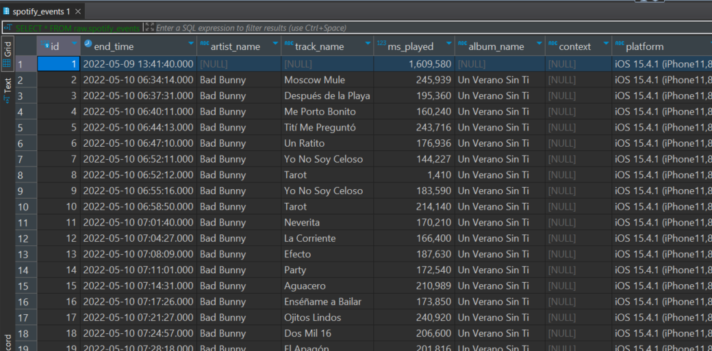
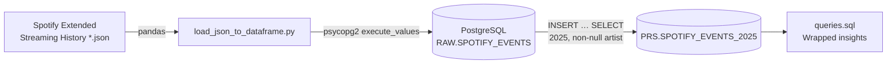

# Spotify Wrapped, DIY — JSON → PostgreSQL → SQL

Build your own "Spotify Wrapped" from your **Spotify Extended Streaming History** export. A Python loader reads every JSON file into pandas and batch-inserts it into a PostgreSQL **RAW** schema. A **PRS** (processed) table keeps only 2025 plays, and a set of SQL queries answers the Wrapped-style questions.



## Architecture



## Tech stack

Python · pandas · psycopg2 · python-dotenv · PostgreSQL · SQL

## What it demonstrates

- **Ingestion:**
  - globs every JSON file in the export folder and concatenates them
  - maps Spotify's field names (`ts`, `master_metadata_*`, `reason_start` …) onto a 24-column table
  - loads it with `execute_values` in a single batch
- **Config hygiene:** database credentials come from a `.env` file, never from code
- **Layered schemas:** `RAW` holds everything as delivered, and `PRS` holds a slim, filtered 2025 table for analysis
- **Analysis queries:**
  - top 5 tracks by minutes and hours
  - total hours listened in 2025
  - top artist and most-played track
  - top listening days, with weekday and month
  - most active hour of the day and listening share by time of day (morning / afternoon / evening / night)
  - first song of the year
  - most-skipped tracks (plays under 5 seconds)

## Project structure

```
.
├── src/load_json_to_dataframe.py   # JSON → pandas → PostgreSQL loader
├── SQLs/
│   ├── DDL.SQL                     # schemas, tables, RAW → PRS load
│   └── queries.sql                 # the "Wrapped" questions
├── SAMPLE_DATA.json                # one anonymised event showing the input shape
├── requirements.txt
└── image*.png                      # screenshots of tables and query results
```

## How to run

1. Request your **Extended streaming history** from Spotify: Account → Privacy → Download your data.
2. Create a PostgreSQL database and run `SQLs/DDL.SQL` up to the `CREATE TABLE` statements.
3. Install the dependencies and create a `.env` file:
   ```bash
   pip install -r requirements.txt
   ```
   ```dotenv
   DB_NAME=postgres
   DB_USER=postgres
   DB_PASSWORD=your_password
   DB_HOST=localhost
   DB_PORT=5432
   ```
4. Put your JSON files in a folder named `Spotify Extended Streaming History/` next to the script, then run:
   ```bash
   python src/load_json_to_dataframe.py
   ```
5. Run the `INSERT INTO PRS…` block from `DDL.SQL`, then the queries in `SQLs/queries.sql`.

## Possible next steps

- Remove the leftover first `try` block in `dump_data_to_postgres` (it opens and closes a connection without doing anything)
- Make the year a parameter instead of hard-coding 2025
- Add a Streamlit or Power BI front end for the results
- Drop `ip_addr` at load time; it isn't needed for analysis
